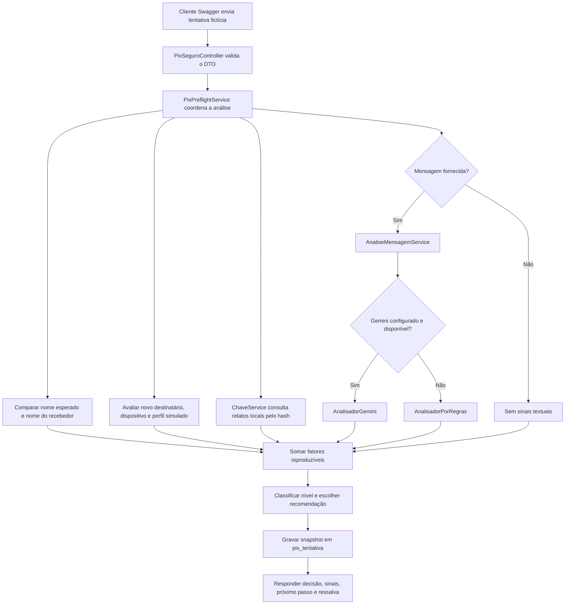

# Guia técnico: fluxo de pré-análise Pix e testes no Swagger

## O que a aplicação simula

A PoC agora tem como fluxo principal uma **pré-análise de uma tentativa Pix fictícia**. Ela combina dados que um simulador de instituição forneceria (valor, recebedor esperado e retornado, destinatário novo, dispositivo e indicação de valor fora do perfil) com dois sinais auxiliares: relatos guardados localmente e sinais extraídos de uma mensagem opcional.

O sistema registra a decisão e suas justificativas. Ele **não inicia, intercepta, autoriza ou bloqueia uma transferência real**. `transferenciaExecutada` é sempre `false`. Num banco integrado de verdade, dados transacionais seriam fornecidos pela instituição; aqui são exemplos sintéticos enviados ao endpoint.

## Fluxo ponta a ponta



A resposta é explicável: cada fator mostra um código, uma fonte, pontos e texto legível. Os pontos são **pesos didáticos de política**, não probabilidades ou desempenho medido em ocorrências reais.

## Percurso dentro do código

### 1. Entrada REST: `web/PixSeguroController.java`

O controller mantém as rotas originais e adiciona três operações em `/api/sandbox/pix`:

- `GET /api/sandbox/pix/cenarios` lista as entradas fictícias carregadas por migration;
- `POST /api/sandbox/pix/preflight` faz uma nova pré-análise;
- `GET /api/sandbox/pix/tentativas/{id}` recupera o registro calculado.

O controller só encaminha os pedidos. A lógica não fica embutida nos métodos HTTP.

### 2. Contratos e validação: `web/Dtos.java`

`PreflightPixRequest` valida um valor positivo, chave e nomes com limite, e mensagem opcional de até 2.000 caracteres. Os booleanos são sinais **da simulação**: `novoDestinatario`, `dispositivoConfiavel` e `valorForaDoPerfil`.

`PreflightPixResponse` devolve o identificador, risco, pontuação didática, decisão recomendada, `transferenciaExecutada=false`, sinais, recomendações, instante e aviso de escopo. `SinalRisco` é o pequeno registro explicativo de cada fator.

### 3. Orquestração: `service/PixPreflightService.java`

O serviço combina todas as fontes, classifica o score, gera recomendações, salva a decisão e produz a resposta. A comparação de nomes ignora acentos, caixa e pontuação: “Café da Praça” e “Cafe da Praca” são tratados como iguais.

Os pesos fixos da versão atual são:

- nome esperado diferente do recebedor: **35**;
- destinatário novo: **15**;
- dispositivo marcado como não confiável: **15**;
- valor marcado como fora do perfil sintético: **20**;
- 1–2 relatos locais sobre a chave: **20**; 3 ou mais: **40**;
- mensagem classificada pelo motor local ou Gemini como média: **20**; alta: **35**; baixa: **0**.

A soma é limitada a 100. A regra de classificação é `ALTO` a partir de 60, `MEDIO` a partir de 20 e `BAIXO` abaixo de 20. Em seguida, o nível determina a recomendação:

- `BAIXO` → `SEGUIR_COM_CAUTELA`;
- `MEDIO` → `PAUSAR_E_CONFIRMAR`;
- `ALTO` → `NAO_CONFIRMAR_E_PEDIR_AJUDA`.

Mesmo no nível baixo, a resposta diz para conferir beneficiário e valor. No nível alto, a aplicação recomenda não confirmar aquela simulação e confirmar por um canal conhecido. Não substitui a política de um banco real.

Sinais de mensagem vêm em duas partes: o fator agregado `RISCO_DA_MENSAGEM` carrega os pontos; `EVIDENCIA_MENSAGEM` lista as descrições retornadas pelo analisador sem duplicar esses pontos. Assim, os itens explicativos não fazem o score ser contado duas vezes.

### 4. Análise textual existente: `AnaliseMensagemService`

Se foi enviada uma mensagem, o preflight chama o serviço já usado por `/api/mensagens/analise`. Com chave Gemini, tenta o modelo remoto. Sem chave ou se a chamada falhar, usa `AnalisadorPorRegras`. A chave de API permanece do lado do servidor.

As regras e o modelo interpretam **o texto fornecido**, não consultam titularidade de chave, base bancária, DICT ou Banco Central. Não forneça conversas reais de outras pessoas numa demonstração pública.

### 5. Reputação local: `ChaveService` e `ChaveHasher`

A chave recebida é normalizada e transformada em SHA-256 antes da busca em `DenunciaRepository`. O texto original não é gravado em `pix_tentativa`. Os relatos existentes são locais e não moderados, então aparecem como `RELATOS_COMUNITARIOS`, acompanhados de uma explicação de que não são verificação oficial nem prova.

Para produção, SHA-256 simples para identificadores pesquisáveis ainda pode permitir tentativa de adivinhação de chaves comuns. A próxima melhoria de privacidade seria um HMAC com segredo operacional e política de rotação, além de controles contra denúncias abusivas.

### 6. Registro e leitura: `PixTentativa` e repositório

Cada análise guarda UUID, hash da chave, valor, risco, pontos, decisão, JSON com snapshot dos sinais e horário. Não guarda nomes da tentativa, nem mensagem bruta. A leitura pelo ID reconstrói as orientações a partir da decisão persistida.

### 7. Cenários prontos: `CenarioPixDemoService`

`GET /api/sandbox/pix/cenarios` converte linhas seedadas no banco em solicitações prontas. Copie o objeto `solicitacao` de uma delas para o corpo do POST. Isso facilita repetir cenários sem alterar o código.

## Banco de dados e migrations

O projeto usa Flyway em `src/main/resources/db/migration`:

- `V1__cria_tabela_denuncia.sql` cria o armazenamento inicial de denúncias;
- `V2__cria_tabela_pix_tentativa.sql` cria a auditoria das pré-análises;
- `V3__cria_cenarios_demo.sql` cria a tabela e insere cenários sintéticos.

`spring.jpa.hibernate.ddl-auto=validate` faz o Hibernate validar o schema que Flyway criou em vez de alterá-lo silenciosamente. No desenvolvimento e testes, o padrão é H2 em memória. É possível configurar outra conexão via `SPRING_DATASOURCE_URL`, `SPRING_DATASOURCE_USERNAME` e `SPRING_DATASOURCE_PASSWORD`; a dependência PostgreSQL e o suporte de migrations estão incluídos.

H2 em memória é reiniciado quando a aplicação reinicia. No Render, os cenários são recarregados pelas migrations somente num banco novo; o seed de denúncias de aplicação é idempotente e controlado por `PIXSEGURO_SEED_DEMO` (padrão `true`). Para persistência entre deploys, conecte um PostgreSQL persistente. O blueprint Render da PoC não cria automaticamente esse banco.

## Como abrir o Swagger

Na raiz do projeto, execute:

```bash
mvn spring-boot:run
```

Abra `http://localhost:8080/swagger-ui.html`. Em **pix-seguro**, expanda as operações. As rotas novas devem aparecer junto às antigas. A sequência mais simples é:

1. Execute `GET /api/sandbox/pix/cenarios`.
2. Copie o valor de `solicitacao` do caso desejado.
3. Execute `POST /api/sandbox/pix/preflight` e cole o objeto como corpo JSON.
4. Confira `risco`, `pontuacao`, `decisao`, `sinais`, `transferenciaExecutada` e `aviso`.
5. Copie `tentativaId` e execute `GET /api/sandbox/pix/tentativas/{id}` para provar que a decisão foi registrada.

A chave Gemini é opcional. Para os exemplos determinísticos, não configure `GEMINI_API_KEY`; o analisador local cobre os textos de demonstração. Com `GEMINI_API_KEY` presente, uma chamada com mensagem pode depender da rede e da disponibilidade do serviço remoto.

## Matriz de cenários no Swagger

Os cenários abaixo estão seedados pela migration V3. Por padrão, as denúncias de demonstração são carregadas por `DadosDemo`; portanto, deixe `PIXSEGURO_SEED_DEMO=true` para reproduzir a contagem comunitária.

| Cenário GET | Sinais esperados | Resultado esperado |
|---|---|---|
| `normal` — pagamento habitual | nome igual, favorecido conhecido, dispositivo confiável, sem mensagem | `BAIXO`, `0`, `SEGUIR_COM_CAUTELA`; nunca transfere |
| `novo-favorecido` — novos dados | favorecido novo + dispositivo desconhecido | `MEDIO`, `30`, `PAUSAR_E_CONFIRMAR` |
| `falso-parente` | troca de número + urgência + recebedor diferente + favorecido novo + dispositivo desconhecido + fora do perfil | `ALTO`, `100` (score limitado), `NAO_CONFIRMAR_E_PEDIR_AJUDA` |
| `chave-denunciada` | três relatos locais seedados para a chave | `MEDIO`, `40`, sinal `RELATOS_COMUNITARIOS`; não é prova oficial |
| `falsa-central` | falsa central pede código, nome diverge, favorecido/dispositivo novos e valor fora do perfil | `ALTO`, `100` (limitado), orientação para não confirmar |

Para testar sem copiar o fixture, estes são corpos válidos equivalentes.

### Cenário 1 — normal

```json
{
  "valor": 45.90,
  "chave": "padaria@demo.invalid",
  "nomeEsperado": "Padaria Central",
  "nomeRecebedor": "Padaria Central",
  "novoDestinatario": false,
  "dispositivoConfiavel": true,
  "valorForaDoPerfil": false
}
```

Esperado: risco baixo, zero pontos e `SEGUIR_COM_CAUTELA`. “Baixo” significa poucos sinais na simulação, não garantia de segurança.

### Cenário 2 — destinatário e dispositivo novos

```json
{
  "valor": 320.00,
  "chave": "loja@demo.invalid",
  "nomeEsperado": "Loja Exemplo",
  "nomeRecebedor": "Loja Exemplo",
  "novoDestinatario": true,
  "dispositivoConfiavel": false,
  "valorForaDoPerfil": false
}
```

Esperado: 30 pontos, risco médio e `PAUSAR_E_CONFIRMAR`. Os dois sinais são provenientes do simulador.

### Cenário 3 — falso parente

```json
{
  "valor": 4500.00,
  "chave": "conta-nova@demo.invalid",
  "nomeEsperado": "Ana Souza",
  "nomeRecebedor": "Marcos Lima",
  "novoDestinatario": true,
  "dispositivoConfiavel": false,
  "valorForaDoPerfil": true,
  "mensagemSuspeita": "Oi mãe, mudei de número. Preciso de um Pix urgente, não liga agora."
}
```

Esperado: score acima de 100 limitado a 100, risco alto e evidências `NOME_DIVERGENTE`, `DESTINATARIO_NOVO`, `DISPOSITIVO_NAO_CONHECIDO`, `VALOR_FORA_DO_PERFIL`, `RISCO_DA_MENSAGEM` e `EVIDENCIA_MENSAGEM`. `transferenciaExecutada` é `false`.

### Cenário 4 — denúncias locais

```json
{
  "valor": 780.00,
  "chave": "golpista@exemplo.com",
  "nomeEsperado": "Loja Exemplo",
  "nomeRecebedor": "Loja Exemplo",
  "novoDestinatario": false,
  "dispositivoConfiavel": true,
  "valorForaDoPerfil": false
}
```

Esperado: três registros de demonstração, 40 pontos, risco médio e um sinal `RELATOS_COMUNITARIOS`. Isso prova apenas que a PoC encontrou relatos locais.

### Cenário 5 — falsa central

```json
{
  "valor": 1250.00,
  "chave": "suporte@demo.invalid",
  "nomeEsperado": "Banco Exemplo",
  "nomeRecebedor": "Pessoa Física Exemplo",
  "novoDestinatario": true,
  "dispositivoConfiavel": false,
  "valorForaDoPerfil": true,
  "mensagemSuspeita": "Sou da central de segurança. Envie o código de verificação por SMS para evitar o bloqueio da conta."
}
```

Esperado: risco alto, fator de mensagem e evidências do motor local. A recomendação deve dizer para não confirmar esta simulação.

### Cenário 6 — equivalência de nomes com acentos

```json
{
  "valor": 30.00,
  "chave": "cafe@demo.invalid",
  "nomeEsperado": "Café da Praça",
  "nomeRecebedor": "Cafe da Praca",
  "novoDestinatario": false,
  "dispositivoConfiavel": true,
  "valorForaDoPerfil": false
}
```

Esperado: a normalização evita criar `NOME_DIVERGENTE`; risco baixo.

### Cenário 7 — validar recusa de entrada inválida

Tente valor zero ou um nome obrigatório vazio. A API deve devolver HTTP `400`, sem criar tentativa. Para garantir, use:

```json
{
  "valor": 0,
  "chave": "teste@demo.invalid",
  "nomeEsperado": "Loja",
  "nomeRecebedor": "Loja",
  "novoDestinatario": false,
  "dispositivoConfiavel": true,
  "valorForaDoPerfil": false
}
```

### Cenário 8 — falha simulada do Gemini

Inicie com `PIXSEGURO_IA_OFFLINE=true` e envie o cenário de falso parente. A camada textual deve declarar o uso de regras locais; a decisão segue disponível. Esse modo precisa ser ativado antes de iniciar a aplicação.

## Rotas originais e cenários restantes do fluxograma

O novo pré-check vira a jornada principal da simulação; as rotas iniciais permanecem disponíveis:

- `POST /api/chaves/consulta` com `{"chave":"golpista@exemplo.com"}` deve mostrar denúncias seedadas e risco local alto.
- `POST /api/mensagens/analise` com `{"texto":"Oi mãe, mudei de número, me faz um Pix urgente?"}` mostra motor, sinais e orientação. Sem Gemini, retorna `motor=REGRAS`.
- `GET /api/autodiagnostico/perguntas` deve listar cinco perguntas; use `POST /api/autodiagnostico` com `{"respostas":[true,true,false,false,false]}` para receber risco médio e recomendações.
- `POST /api/decisao` com `{"risco":"ALTO","confirmacao":null}` orienta não pagar e confirmar por outro canal. Troque a confirmação por `E_GOLPE`, `NAO_DEU_PARA_CONFIRMAR` ou `NAO_E_GOLPE` para exercitar cada saída. Risco baixo leva ao próximo passo cauteloso.
- `POST /api/denuncias` com `{"chave":"relato-novo@demo.invalid","descricao":"Relato sintético de teste","jaFezPix":false}` cria uma denúncia e alerta futuro; use uma chave inventada.
- `POST /api/denuncias` com `{"chave":"vitima-demo@demo.invalid","descricao":"Transferência após mensagem falsa","jaFezPix":true}` retorna orientações de contato ao banco, MED e registro de B.O. A PoC não protocola contestação e não garante devolução.
- `GET /actuator/health` verifica se o serviço está de pé.

A rota antiga `POST /api/decisao` continua aceitando um nível de risco informado pelo chamador para preservar o fluxograma original. Para a nova jornada, use `POST /api/sandbox/pix/preflight`: ele recebe sinais da tentativa fictícia e **calcula** a recomendação no servidor.

## Testes automatizados e execução

Execute todos os testes na raiz:

```bash
mvn clean test
```

A suíte verifica regras locais, fluxos antigos, indisponibilidade da IA, cenários seedados, decisões baixa/média/alta, divergência de nome, denúncias locais, persistência/leitura por ID e validação do valor. Os fixtures são artificiais; não são dados de clientes ou do Bradesco.

## Limites antes de publicar

A API serve para demonstração com payloads fictícios. Ela ainda não tem autenticação, autorização, rate limit nem moderação de denúncia. Não publique para coletar denúncias reais e não envie dados bancários ou conversas reais. No Render, o padrão continua H2 em memória; conecte PostgreSQL persistente e configure credenciais protegidas se precisar preservar dados. O Gemini é opcional e não representa serviço bancário.
